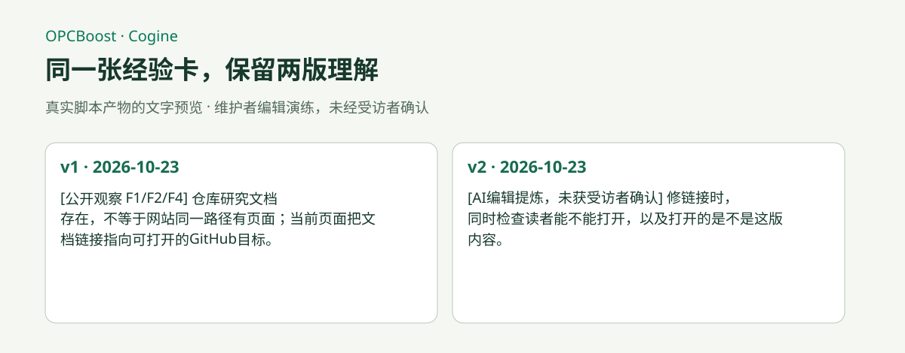

# OpenClaw 中文最佳实践库（awesome-openclaw-zh）

一个面向中文用户的 OpenClaw 开源仓库：
**先看一份真实成果，下载材料，再跑通自己的第一个场景。**

**[在线阅读与搜索：OPCBoost](https://www.opcboost.com/) · [龙虾造物工坊：六个新玩法](./resources/08-autumn-makers.md) · [六个新玩法与实验入口](./resources/07-new-playbooks-lab.md) · [三份可复刻成果](./resources/06-reproducible-showcase.md)**

由 **[Cogine 团队](https://www.cogine.ai/)** 整理与维护。觉得有用，欢迎点击仓库右上角 **Star** 收藏，方便再次找到这些案例；订阅更新可使用 GitHub 的 **Watch → Custom → Releases**。

本仓库当前覆盖三类核心内容：

- 部署与配置：Mac、Windows、Linux VPS、多 Agent
- 渠道接入：飞书、钉钉、企业微信、QQ（持续补充）
- 使用场景：218 个来源可追溯的案例、工作流与原创实验

## 最近更新：2026 年 10 月

10 月 30 日新增[龙虾造物工坊六案例专题](./resources/08-autumn-makers.md)：3D工作台、发布短片、学习包、模拟用户大会、播客观点地图和打印物料。每例配有预览、输入、运行步骤和ZIP材料包，可直接改成自己的作品。

10 月 27 日新增桌面教学卡、共享记忆接棒、数字人口播准备、B站选题简报、文案匿名擂台与本地决策小游戏六个玩法。提供九份ZIP材料包，包含输入、脚本和示例作品。

- [本期：六个新玩法与接入实验](./resources/07-new-playbooks-lab.md)
- [本期：三份可复刻成果](./resources/06-reproducible-showcase.md)
- [10 月新玩法与选题依据](./resources/05-october-new-playbooks.md)
- [第一次体验：三个中文工作场景](./quickstart/02-first-three-workflows.md)
- [更新记录](./CHANGELOG.md)

### 先用一份离线成果开始

[打开经验卡教程](./usecases/productivity/experience-interview-record-card.md) · [下载完整材料](./assets/bundles/experience-card-2026-10-27.zip) · [分享你做出的版本](https://github.com/cogine-ai/awesome-openclaw-zh/issues/new/choose)

只需Python即可离线重跑两版经验卡，保留历史、事实和编辑建议；可直接替换成自己的经历。先体验具体产物，再按下面的部署和渠道入口继续。

## 开始使用 OpenClaw

### 还没部署

1. [部署与配置中心](./deploy/README.md)
2. [部署后 5 分钟快速体验](./quickstart/00-5min-quickstart.md)
3. [7 天上手路径](./quickstart/01-7day-path.md)

### 已经部署好

1. [部署后 5 分钟快速体验](./quickstart/00-5min-quickstart.md)
2. [7 天上手路径](./quickstart/01-7day-path.md)
3. [按分类找案例（218 个）](./resources/usecases-index.md)

### 推荐部署入口

- 有 Mac：看 [macOS 本地部署](./deploy/01-macos-local.md)
- 用 Windows：看 [Windows 部署（WSL2 主线）](./deploy/02-windows.md)
- 想 24 小时在线：看 [Linux VPS 通用部署](./deploy/03-linux-vps-baseline.md)
- 想配置多个长期 Agent：看 [如何创建多个 OpenClaw Agent](./deploy/04-create-multi-agent.md)

### 推荐渠道入口

- [飞书接入对话（基础篇）](./channels/02-feishu-basic.md)
- [企业微信接入对话](./channels/01-wecom-intelligent-bot.md)
- [钉钉 AI 助手](./usecases/productivity/13-dingtalk-ai-assistant.md)

## 你可以先从这 10 个案例开始尝试

- [每日晨间简报](./usecases/everyday/52-morning-briefing-telegram.md)
- [收件箱整理](./usecases/productivity/inbox-declutter.md)
- [多渠道 AI 客户服务](./usecases/productivity/multi-channel-customer-service.md)
- [家庭日历与家务助理](./usecases/productivity/family-calendar-household-assistant.md)
- [个人知识库 (RAG)](./usecases/research/knowledge-base-rag.md)
- [多智能体专业团队](./usecases/productivity/multi-agent-team.md)
- [YouTube 内容流水线](./usecases/creative/youtube-content-pipeline.md)
- [Trello/Notion 整理](./usecases/everyday/66-trello-notion-organizer.md)
- [智能日历提醒](./usecases/everyday/55-calendar-smart-reminder.md)
- [社交媒体监控](./usecases/everyday/64-social-media-monitor.md)

## 分类导航

- [全量用例索引（218）](./resources/usecases-index.md)
- [社交媒体（9）](./usecases/social)
- [创意与构建（22）](./usecases/creative)
- [基础设施与 DevOps（13）](./usecases/devops)
- [生产力（34）](./usecases/productivity)
- [研究与学习（15）](./usecases/research)
- [金融与交易（2）](./usecases/finance)
- [日常生活（33）](./usecases/everyday)
- [内容转换（18）](./usecases/content)
- [内存管理（12）](./usecases/memory)
- [夜间自动化（16）](./usecases/automation)
- [数据分析（16）](./usecases/data)
- [安全监控（16）](./usecases/security)
- [工具开发（12）](./usecases/tools)

## 部署与运行建议

- [部署与配置中心](./deploy/README.md)
- [安装与部署入口（小白版）](./resources/01-install-and-deploy.md)
- [模型、渠道、技能怎么选](./resources/02-model-channel-skill-guide.md)
- [如何创建多个 OpenClaw Agent](./deploy/04-create-multi-agent.md)
- [低成本稳定运行（精简版）](./playbooks/01-low-cost-stable-run.md)
- [安全与权限边界（非技术版）](./playbooks/02-safe-usage-boundary.md)

## 投稿与共建

- [贡献指南](./CONTRIBUTING.md)
- [用例模板](./usecases/TEMPLATE.md)
- [报告失效步骤 / 分享跑通的案例](https://github.com/cogine-ai/awesome-openclaw-zh/issues/new/choose)

不会提交 PR 也可以直接用 Issue 投稿：告诉我们你想完成什么、用了什么工具、得到什么结果。

## 说明与致谢

本仓库最初是我们团队自己内部分享使用 OpenClaw 的经验，其中许多出自于以下仓库或官方资料：

- [openclaw/openclaw](https://github.com/openclaw/openclaw)
- [OpenClaw Docs](https://docs.openclaw.ai/)
- [hesamsheikh/awesome-openclaw-usecases](https://github.com/hesamsheikh/awesome-openclaw-usecases)
- [digitalknk/openclaw-runbook](https://github.com/digitalknk/openclaw-runbook)
- [SamurAIGPT/awesome-openclaw](https://github.com/SamurAIGPT/awesome-openclaw)
- [rohitg00/awesome-openclaw](https://github.com/rohitg00/awesome-openclaw)
- [xianyu110/awesome-openclaw-tutorial](https://github.com/xianyu110/awesome-openclaw-tutorial)
- [EvoLinkAI/awesome-openclaw-usecases-moltbook](https://github.com/EvoLinkAI/awesome-openclaw-usecases-moltbook)

每个用例页或部署文档都会尽量保留来源线索，方便追溯和持续维护。
